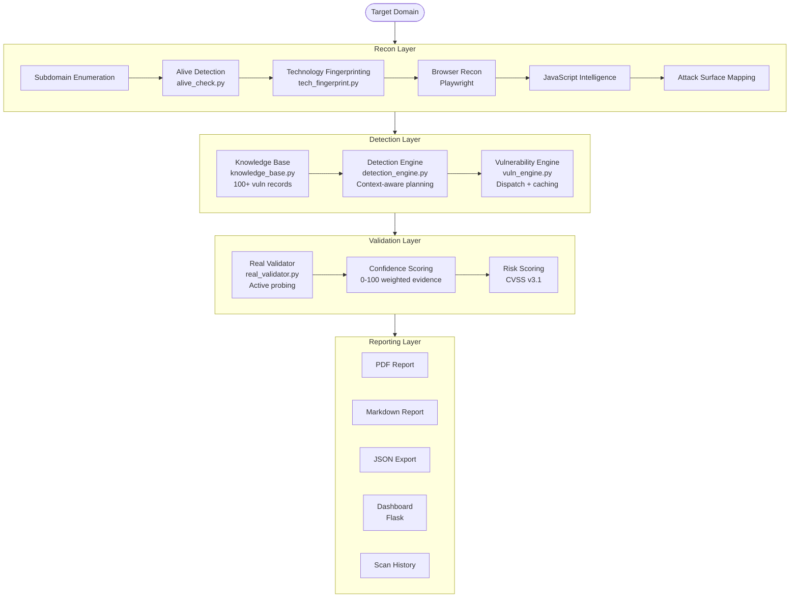

# AI Bug Bounty Recon Platform

> A modular reconnaissance and web application assessment platform for bug bounty hunters, penetration testers, and AppSec engineers.


---

## Table of Contents

- [Overview](#overview)
- [Features](#features)
- [Architecture](#architecture)
- [Screenshots](#screenshots)
- [Installation](#installation)
- [Usage](#usage)
- [Modules](#modules)
- [Detection Capabilities](#detection-capabilities)
- [Reporting](#reporting)
- [Dashboard](#dashboard)
- [Roadmap](#roadmap)
- [Known Limitations](#known-limitations)
- [Contributing](#contributing)
- [Disclaimer](#disclaimer)

---

## Overview

Most vulnerability scanners run a fixed list of checks and produce a flat findings list. This platform takes a different approach: it builds a structured understanding of a target before it tests anything.

The platform chains passive reconnaissance, technology fingerprinting, JavaScript intelligence, and attack surface mapping into a single pipeline. A knowledge base of 100+ vulnerability profiles drives the detection engine, which selects and prioritises tests based on what it has actually observed about the target — not a generic checklist. Confirmed findings are validated with active probes before being written to the report.

**Built for:**

- Bug bounty hunters who need fast, structured recon on large scopes
- Penetration testers who want reproducible, evidence-backed findings
- AppSec engineers who need programmatic JSON output for pipeline integration
- Security researchers studying attack surface analysis and chained exploits

**How it differs from traditional scanners:**

| Aspect | Traditional Scanner | This Platform |
|--------|--------------------|--------------------|
| Detection logic | Fixed plugin list | Knowledge-base driven, context-aware |
| Technology detection | Header-only | Headers + HTML + JS globals + cookies + meta tags |
| Validation | Heuristic | Active confirmation with confidence scoring |
| Reporting | Generic | Finding cards with CWE, OWASP, CAPEC, business impact |
| Attack surface | URL list | Chained attack paths, high-value target scoring |
| Dashboard | None / basic | Interactive Flask dashboard with history and charts |

---

## Features

### Reconnaissance
- Subdomain enumeration via multiple sources
- Alive host detection with [httpx](https://github.com/projectdiscovery/httpx) integration and manual fallback
- IPv4-forced connection pooling with WAF detection
- Browser-based reconnaissance using Playwright
- JavaScript file discovery and parsing
- Secret and credential pattern detection in JS and HTML
- Directory and endpoint discovery

### Detection
- Knowledge base with 100+ vulnerability records and CVSS v3.1 scoring
- Framework intelligence profiles for 29 frameworks
- Detection engine that selects tests based on observed technology context
- Vulnerability engine with dispatch table and plan caching
- Attack surface mapper with chained exploit path analysis
- High-value target scoring

### Validation
- Active confirmation for: XSS, SQLi, SSRF, LFI, SSTI, Open Redirect
- Confidence scoring with weighted evidence accumulation (0–100)
- Baseline response comparison to reduce false positives
- Time-based SQLi detection with baseline subtraction
- Per-finding validation status: Confirmed / Likely / Needs Manual Review / Rejected

### Reporting
- PDF reports with severity badges and evidence tables
- Markdown reports with collapsible evidence blocks, tables, and Mermaid diagrams
- JSON export with full schema: findings, attack surface, tech stack, chart data
- Executive summary with risk distribution and highest-risk findings
- Per-finding cards: CWE, OWASP, CAPEC, business impact, remediation, references

### Dashboard
- Interactive Flask web UI
- Live scan progress
- Findings table with filters
- Attack surface visualisation
- Technology distribution charts
- Scan history with diff view
- PDF and JSON download

### AI Intelligence
- Claude API integration for exploit PoC generation
- AI-assisted finding prioritisation
- Natural-language remediation guidance
- Contextual risk narrative in executive summary

---

## Architecture



---

## Screenshots

> Screenshots will be added as the dashboard UI stabilises.

| View | Preview |
|------|---------|
| Dashboard — Overview | `docs/screenshots/dashboard.png` |
| Live Scan Progress | `docs/screenshots/live_scan.png` |
| Findings Table | `docs/screenshots/findings.png` |
| Attack Surface Graph | `docs/screenshots/attack_surface.png` |
| PDF Report | `docs/screenshots/pdf_report.png` |
| Scan History | `docs/screenshots/history.png` |

---

## Installation

### Requirements

| Dependency | Version | Notes |
|------------|---------|-------|
| Python | 3.12+ | Required |
| pip | Latest | Required |
| Go | 1.21+ | Optional — for httpx alive detection |
| httpx (ProjectDiscovery) | Latest | Optional — faster alive check |
| Playwright | Latest | Optional — browser recon |
| Git | Any | Required |

### 1. Clone the repository

```bash
git clone https://github.com/yourhandle/ai-bug-bounty-recon.git
cd ai-bug-bounty-recon
```

### 2. Create a virtual environment

```bash
python3 -m venv venv
source venv/bin/activate        # Linux / macOS
# venv\Scripts\activate         # Windows (WSL recommended)
```

### 3. Install Python dependencies

```bash
pip install -r requirements.txt
```

### 4. Install Playwright browsers (optional — required for browser recon)

```bash
playwright install chromium
```

### 5. Install httpx (optional — recommended for faster alive detection)

```bash
# Requires Go 1.21+
go install -v github.com/projectdiscovery/httpx/cmd/httpx@latest
```

Ensure `$GOPATH/bin` is in your `$PATH`:

```bash
export PATH="$PATH:$(go env GOPATH)/bin"
```

### 6. Configure environment

```bash
cp .env.example .env
# Edit .env and add your Anthropic API key if using AI features
```

### 7. Run the platform

```bash
# Start the dashboard
python app.py

# Or run a scan directly from the CLI
python recon_core.py --domain example.com
```

---

## Usage

### Basic scan

```bash
python recon_core.py --domain target.com
```

### Scan with all modules

```bash
python recon_core.py --domain target.com --full
```

### Scan with custom wordlist

```bash
python recon_core.py --domain target.com --wordlist /path/to/subs.txt
```

### Generate all report formats

```bash
python recon_core.py --domain target.com --report all
```

### Start the dashboard

```bash
python app.py
# Open http://localhost:5000
```

### Example workflow

```
[1] Input: target.com

[2] Recon
    → Subdomain enumeration: api, admin, dev, staging (4 found)
    → Alive check: 3/4 hosts alive
    → Tech fingerprint: nginx 1.24, Django, Cloudflare, React

[3] Detection
    → KB lookup: Django context → SSTI, CSRF, debug endpoints
    → Detection engine: 8 tests planned
    → Vulnerability engine: 3 candidates found

[4] Validation
    → SSTI confirmed on /search?q= (confidence: 85)
    → SQLi: needs manual review (confidence: 42)
    → Open Redirect: rejected (confidence: 10)

[5] Report
    → reports/target_com_report.pdf
    → reports/target_com_report.json
    → reports/target_com_report.md
```

### Example terminal output

```
[+] Checking 4 hosts for alive status...

[ALIVE] https://target.com         | status=200 | rt=143ms | ip=104.21.x.x | waf=Cloudflare
[ALIVE] https://api.target.com     | status=200 | rt=198ms | ip=104.21.x.x | server=nginx/1.24
[ALIVE] https://admin.target.com   | status=403 | rt=89ms

[+] Technology fingerprint: nginx, Django, React, Cloudflare, HSTS Enabled
[+] Detection plan: 8 tests across 3 endpoints
[+] SSTI CONFIRMED | param=q | payload={{7*7}} | confidence=85
[+] Text report saved: reports/target_com_report.txt
[+] JSON report saved: reports/target_com_report.json
[+] Markdown report saved: reports/target_com_report.md
```

---

## Modules

```
ai-bug-bounty-recon/
├── ai_engine/          # AI-assisted analysis and PoC generation
├── core/               # Scanning and detection engine
├── dashboard/          # Flask web UI and API routes
├── reports/            # Generated scan reports (gitignored)
├── utils/              # Shared utilities
├── app.py              # Dashboard entry point
├── recon_core.py       # CLI scan orchestrator
└── requirements.txt
```

### `ai_engine/`

Handles Anthropic Claude API integration. Generates exploit proof-of-concept descriptions, natural-language remediation guidance, and risk narrative for the executive summary. Degrades gracefully if no API key is configured.

### `core/`

The main scanning pipeline:

| File | Responsibility |
|------|----------------|
| `knowledge_base.py` | 100+ vulnerability records, CVSS scores, framework profiles, compliance mappings |
| `detection_engine.py` | Context-aware test planning; selects checks based on observed tech stack |
| `vuln_engine.py` | Dispatches and executes vulnerability checks; caches detection plans |
| `recon_core.py` | Top-level orchestrator; coordinates all scan stages |
| `alive_check.py` | Host availability engine; httpx + manual fallback, WAF detection, IP resolution |
| `tech_fingerprint.py` | Technology fingerprinting from headers, HTML, JS globals, cookies, meta tags |
| `real_validator.py` | Active validation engine; XSS, SQLi, SSRF, LFI, SSTI, Open Redirect |
| `attack_surface.py` | Attack surface mapper; chains exploit paths, scores high-value targets |

### `dashboard/`

Flask web application providing:
- Live scan control and progress streaming
- Findings browser with severity filters
- Technology and attack surface visualisations
- Scan history and report downloads
- Chart data rendered from JSON export

### `reports/`

Output directory for generated reports. This directory is gitignored. Reports are named `{domain}_report.{ext}`.

### `utils/`

Shared utilities: structured logger, HTTP helpers, rate limiter, file I/O wrappers.

---

## Detection Capabilities

| Category | Vulnerability Classes |
|----------|-----------------------|
| Injection | SQL Injection (error-based, time-based), Command Injection, SSTI, XXE |
| Client-side | Reflected XSS, Stored XSS, DOM XSS, HTML Injection |
| Access Control | Open Redirect, SSRF, Path Traversal / LFI, Insecure Direct Object Reference |
| Authentication | Broken Authentication, Session Fixation, Weak Credentials |
| Configuration | Missing Security Headers, Directory Listing, Debug Endpoints, Exposed Admin Panels |
| Information Disclosure | Sensitive Data in JS, Stack Traces, Server Version Disclosure, Secret Leakage |
| Infrastructure | Subdomain Takeover indicators, Dangling DNS, Misconfigured CORS |
| Third-party | Vulnerable JavaScript Libraries, Exposed API Keys, Hardcoded Credentials |

Detection is driven by the knowledge base. Each vulnerability record carries CVSS v3.1 scoring, CWE, OWASP category, CAPEC reference, framework associations, and remediation guidance.

---

## Reporting

Three report formats are generated after each scan.

### PDF

Structured document with:
- Cover page with domain, date, and overall risk level
- Executive summary table
- Finding cards (severity badge, CVSS, evidence, remediation)
- Attack surface section
- Technology stack
- Recommendations

### Markdown

GitHub/GitLab-compatible with:
- Proper heading hierarchy
- Severity and metric tables
- Collapsible `<details>` blocks for evidence and endpoint lists
- Code blocks for payloads and PoC URLs
- Mermaid-ready data references

### JSON

Full-fidelity export for programmatic consumption:

```json
{
  "scan_metadata": { ... },
  "risk_summary": { ... },
  "findings": [ ... ],
  "findings_enriched": [ ... ],
  "attack_surface_detail": { ... },
  "technology_details": [ ... ],
  "validation_details": { "Confirmed": [...], "Likely": [...] },
  "statistics": { ... },
  "chart_data": { ... }
}
```

All report formats are generated by `report_generator.py` and saved to `reports/`.

---

## Dashboard

The dashboard is a Flask application (`app.py`) serving a web UI at `http://localhost:5000`.

| Page | Description |
|------|-------------|
| `/` | Overview — active scan status, recent findings, risk score |
| `/scan` | Start a new scan, configure options, monitor live progress |
| `/findings` | Full findings table with severity, confidence, and validation filters |
| `/attack-surface` | Attack surface graph, high-value targets, exploit chains |
| `/technologies` | Detected technology stack with confidence scores |
| `/history` | Past scan list with date, domain, finding counts |
| `/reports` | Download PDF, JSON, and Markdown for any historical scan |

Charts are rendered using Chart.js from the `chart_data` block in the JSON export. No external chart services are used.

---

## Roadmap

### Completed
- [x] Knowledge base with 100+ vulnerability records and CVSS v3.1 scoring
- [x] Detection engine with context-aware test planning
- [x] Alive check with httpx integration, WAF detection, connection pooling
- [x] Technology fingerprinting from 8 signal sources
- [x] Active validation: XSS, SQLi, SSRF, LFI, SSTI, Open Redirect
- [x] Confidence scoring with weighted evidence accumulation
- [x] Attack surface mapper with chained exploit path analysis
- [x] Report generator: PDF, Markdown, JSON
- [x] Flask dashboard with live scan and history
- [x] Claude API integration for PoC generation

### In Progress
- [ ] Nuclei template integration for additional checks
- [ ] Authenticated scan support (session cookie / token injection)
- [ ] GraphQL endpoint detection and testing
- [ ] Improved subdomain enumeration sources

### Future Ideas
- [ ] CI/CD integration mode (exit code on critical findings)
- [ ] Team / multi-user dashboard with scan sharing
- [ ] Scheduled recurring scans
- [ ] Webhook notifications (Slack, Discord)
- [ ] SARIF export for GitHub Code Scanning integration
- [ ] Scope-aware scanning with allow/block lists
- [ ] Burp Suite extension for importing recon results

---

## Known Limitations

- **Authenticated content**: The platform does not currently support multi-step login flows. Scans are unauthenticated by default. Passing a session cookie is possible but not formally supported.
- **JavaScript-heavy SPAs**: The browser recon module (Playwright) handles basic JS rendering, but complex single-page applications with heavy client-side routing may result in incomplete endpoint discovery.
- **Rate limiting**: No built-in token-bucket rate limiter is implemented at the orchestrator level. Aggressive scans against rate-limited targets may produce incomplete results or temporary blocks.
- **False positives in time-based SQLi**: Time-based detection uses baseline subtraction, but high-latency or variable-response-time servers can still produce false positives. Manual confirmation is advised.
- **httpx dependency**: The alive check module prefers the ProjectDiscovery `httpx` binary. The Python fallback works but is slower on large subdomain lists.
- **No IPv6 support**: The platform forces IPv4 connections. Targets that are only reachable over IPv6 will not be scanned.
- **Single-target only**: Batch scanning across multiple root domains in one session is not currently supported.

---

## Contributing

Contributions are welcome. Please follow these steps:

1. Fork the repository
2. Create a feature branch: `git checkout -b feature/your-feature-name`
3. Make your changes with clear commit messages
4. Ensure existing functionality is not broken
5. Open a pull request with a description of what was changed and why

**Areas particularly welcome:**
- New knowledge base vulnerability records
- Additional technology fingerprint signatures
- Detection engine improvements
- Test coverage
- Documentation

Please open an issue before starting large changes to discuss the approach.

---

## Disclaimer

**This tool is intended solely for authorised security testing and educational purposes.**

You are responsible for ensuring you have explicit written permission from the system owner before running any scan. Unauthorised use of this tool against systems you do not own or have permission to test is illegal in most jurisdictions and may result in criminal prosecution.

The authors accept no liability for misuse of this software. Use responsibly, ethically, and legally.

---

*AI Bug Bounty Recon Platform — built for security professionals, by security professionals.*
